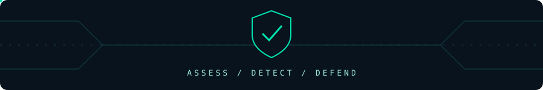

**Offensive Security · Defensive Security · Digital Forensics**

 &nbsp;
 &nbsp;

---

## About Me

Cybersecurity postgraduate at Amity University Rajasthan with a background in forensic science and hands-on experience in controlled penetration testing, vulnerability assessment, network traffic analysis and security monitoring. My work focuses on identifying security weaknesses, investigating threats and building detection systems.

Open to cybersecurity internships, entry-level roles and research collaborations.

  

## Technical Skills

**Offensive Security** — VAPT, OWASP Top 10, Web Application Security, Network Security, RBAC

**Defensive Security** — SOC Monitoring, Incident Response, Threat Intelligence, IOC Analysis, UEBA, Endpoint Monitoring, Data Exfiltration Detection

**Digital Investigation** — Digital Forensics, OSINT, Digital Evidence Analysis, Forensic Investigation

## Tools & Environments

  

  
  
  
  
  
  

**Security testing:** Burp Suite · Nmap · Metasploit · OWASP ZAP · Postman

**Network analysis:** Wireshark

**Digital forensics:** Autopsy · FTK · Belkasoft

**Platforms:** Kali Linux · Linux · Windows · Docker · Windows Event Logs

---

## Featured Projects

### Hybrid ML-Based Insider Threat Detection and Active Defense System

*Flagship minor project — Amity University Rajasthan*

A Windows endpoint security platform combining behavioral analytics, machine learning, hybrid risk scoring, and automated incident response.

- Integrated Isolation Forest, PyTorch LSTM, and statistical baselines for User and Entity Behavior Analytics (UEBA).
- Monitored Windows Security Event Logs, USB activity, file access, clipboard operations, process execution, and network egress with RBAC-based policy checks.
- Built a Flask central server and Streamlit SOC dashboard with explainable alerts and SQLite offline event buffering.
- Implemented automated forensic evidence capture and workstation locking.

**Benchmark results** — 98.42% accuracy · 98.15% F1-score (CMU CERT v4.2)

**Observed detection latency** — 1.2–1.8 seconds (VMware simulations)

**Stack:** Python · PyTorch · Scikit-learn · Flask · Streamlit · SQLite · Windows Event Logs · VMware

**Focus:** Insider Threats · UEBA · Endpoint Security · Data Exfiltration Detection · Active Defense

---

### Hybrid Machine Learning-Based Intrusion Detection System (IDS)

A real-time intrusion detection system combining supervised and unsupervised machine learning with deep learning for network threat detection.

- Integrated Random Forest, DBSCAN, and Autoencoder models.
- Implemented live packet analysis and anomaly detection in a SOC-style monitoring environment.
- Trained using the CICIDS2017 dataset and validated detection of live port scans in a controlled Kali Linux environment.

**Focus:** Network Security · Machine Learning · Anomaly Detection · IDS

### Penetration Testing & Vulnerability Analysis — Belkasoft Forensic Software

- Investigated session-management vulnerabilities and cookie-based security flaws.
- Analyzed session IDs and tokens in the context of unauthorized access.
- Conducted vulnerability assessment and documented technical findings.

**Focus:** Web Security · Session Management · Vulnerability Assessment · Technical Reporting

<!-- Add verified repository links to the projects when available. -->

## Internship Experience

### Redynox — Cyber Security Intern
*June – July 2026 · Remote*

OWASP WebGoat, controlled SQL injection exercises, HTTP request analysis, DNS and TLS 1.3 traffic analysis, and Windows Defender Firewall configuration.

### Codec — Cyber Security Intern
*September 2025 · Remote*

Web application security testing using Burp Suite and PortSwigger labs, including controlled XSS and SQL injection testing.

## Education

- **M.Sc. Cyber Security** — Amity University Rajasthan (Expected 2027)
- **B.Sc. (Hons.) Forensic Science** — Medicaps University, Indore (2025)

## Certifications

- Ethical Hacking Principles — Coursera (SkillUp), 2026
- Cybersecurity Certificate Course — Tech Mahindra, 2024
- Ethical Hacking Essentials (EHE) — EC-Council, 2024
- Digital Forensic Essentials (DFE) — EC-Council, 2023

## Activities & Achievements

- AI/ML for Geodata Analysis — IIRS (ISRO)
- AWS Awesome Day — Amazon Web Services
- Author of *Whispers of Forever: Lessons in True Commitments* (2025)

## Contribution Activity

  

<!-- Snake becomes available after running the Contribution snake workflow. -->

  

[Explore my repositories](https://github.com/ankit1109-h?tab=repositories)

## Languages

English (Professional) · Hindi (Professional) · German (Beginner)

## Connect With Me

- GitHub: [@ankit1109-h](https://github.com/ankit1109-h)

- LinkedIn: [Ankit Pathak](https://linkedin.com/in/ankit-pathak1119)
- Email: [ankitpathak.1119@gmail.com](mailto:ankitpathak.1119@gmail.com)

---

**Learn continuously. Investigate responsibly. Build securely.**

Security research and testing should always be conducted ethically and with appropriate authorization.

